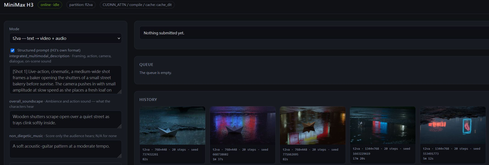

# h3-ui

**English** | [繁體中文](README.zh-TW.md)

A thin browser frontend for video generation on a [vLLM-Omni](https://github.com/vllm-project/vllm-omni) server.

One file, standard library only, no build step. Point it at a running server and open a browser.



It exists because talking to `/v1/videos/sync` by hand is tedious: multipart bodies, base64 attachments, an API key you don't want in your shell history, and generations long enough that a dropped connection loses the result. This sits in front of that and keeps the key server-side.

## What it does

- **Text, first-frame, and reference conditioning**: the task list is read from the served checkpoint, so the UI matches whatever partition is loaded rather than offering options the server will reject.
- **Attachment rules enforced before submitting**: each task states what it accepts, and the form refuses mismatched combinations instead of letting the server reject them.
- **A real queue**: submit as many jobs as you like without waiting. One worker per configured upstream drains them in submission order, so you can line up a batch and walk away. Queued jobs can be cancelled, and on a current vLLM-Omni so can a running one: it stops at the next denoising step.
- **The rest of what H3 serves**: long video up to 300 seconds, a soundtrack that drives the clip, latent-mask editing of an existing clip, timeline guides and latent upscaling, each refused up front in the combinations the server refuses. See [Request features](#request-features).
- **Jobs survive the page**: generation runs server-side against a job id, so closing the tab or losing Wi-Fi doesn't kill a ten-minute render. The finished video appears whenever you come back.
- **Reproducible by default**: every result writes a sidecar JSON beside the video with the parameters you chose and the exact fields that went to the server.
- **Random seeds**: 🎲 draws one on demand; the checkbox draws a fresh one per generation. Either way the drawn value is written into the seed box and shown on completion, so a lucky result is never lost to a number you can't recover.
- **Structured prompts**: H3 expects three named sections rather than free text. The form gives you each one, with a format crib sheet, and builds the FL2VA alignment line from the duration you set so its timestamp can't drift out of sync. Plain text still works if you'd rather write it yourself.
- **Delete what didn't work**: trial runs and failures can be removed from the history, video and sidecar together.

## Requirements

- Python 3.10+, standard library only, nothing to install
- A reachable vLLM-Omni or FastVideo server serving MiniMax-H3

## Server compatibility

h3-ui speaks three vLLM-Omni request contracts, chosen with `H3_SERVER_CONTRACT`.

`current` (the default) is v0.30.0 and later. Since
[#7219](https://github.com/vllm-project/vllm-omni/pull/7219) (merged 2026-09-24),
`num_inference_steps` counts denoiser evaluations. Before it, N steps built N
sigma points and so ran N-1 forwards; now they build N+1 and run N. A base
render at the same number is one forward longer than it used to be, and the
Turbo adapter's check moved with it: the 4 step file wants `4` where it wanted
`5`.

`2026-08` is the 2026-08-22 nightly through v0.29.x. Steps still count sigma
points there, and two rules that `current` keeps were introduced:

- Output duration has to be between 4 and 15 seconds. A 2 second request comes
  back as `MiniMax H3 output duration must be in [4, 15] seconds`, so the
  duration box is bounded here rather than upstream.
- `t2va` needs an explicit named `aspect_ratio`, one of `21:9`, `16:9`, `4:3`,
  `1:1`, `3:4`, `9:16`. The form sends the name closest to the canvas you set;
  `width` and `height` still decide the canvas, exactly as the upstream recipe
  pairs 960x576 with `16:9`. `fl2va` takes its ratio from the input image and
  `ref2va` defaults to 16:9, so neither is sent one.

`legacy` is the `minimax-h3` image published on 2026-08-02: the canvas alone was
enough and nothing bounded the duration from below. Set it if you still run that
image.

Rejections the server classes as client errors come back as `400` on main since
[#8474](https://github.com/vllm-project/vllm-omni/pull/8474) and
[#8713](https://github.com/vllm-project/vllm-omni/pull/8713); v0.31.0rc1 and
earlier answer the same messages with a `500`. h3-ui shows the code as it
arrives either way.

### FastVideo

[FastVideo](https://github.com/hao-ai-lab/FastVideo) also serves MiniMax-H3 at
`POST /v1/videos/sync`, with a JSON body instead of multipart. Set
`H3_BACKEND_KIND=fastvideo` for such an upstream. It differs in ways the queue
has to respect:

- It takes `t2va` only, and has no request-switchable LoRA.
- It counts frames on H3's `17n+5` grid between 124 and 362 at 24 fps, so the
  clip has to be 4.5 to 15 seconds. 4.4 s rounds to 107 frames and is refused.
- `num_inference_steps` counts sigma points: the same four step render is
  `steps=5` here and `steps=4` on vLLM-Omni.
- The model name must match the alias it advertises, `fasth3` by default and
  `compacth3` for the CompactH3 configs. Set `H3_FASTVIDEO_MODEL` to match.

### FastH3

[FastH3](https://haoailab.com/blogs/fasth3-preview/) is FastVideo's DMD2 student
of MiniMax-H3, and it comes in two shapes.

**V1 is a four step adapter.** vLLM-Omni fuses it into the checkpoint at load
time from `--lora-path`; it is not a request-switchable LoRA, so a fused server
changes the request contract rather than offering an option:

- `num_inference_steps` must be exactly 4 on vLLM-Omni, 5 on FastVideo.
- Only `t2va` is served, because preview v1 distils only that task.
- `flow_shift` and `audio_flow_shift` are owned by the fused schedule. The
  server accepts a value only when it equals the checkpoint's own, and answers
  `FastH3 requires flow_shift=12, got 8` for anything else. h3-ui omits them
  rather than echoing a form default, which is the only option that cannot
  disagree with a schedule this process never sees.

Nothing on the wire says the adapter is fused: `/v1/models` is unchanged and so
is `model_index.json`. So h3-ui cannot detect it and has to be told, with
`H3_LORA_PATH` (the same value the server was given) or `H3_FASTH3`. When told,
the steps box locks, both shift boxes disappear, the mode list narrows to
`t2va`, and every result records which adapter produced it.

On one GB10 with online FP8, full compute, 960x576, 4.4 s, seed 1101, the
adapter took a 50 step render from 1034 s to 114 s, and 63 s at 768x448.

**8-Step V2 is a full checkpoint**
([vllm-omni#7610](https://github.com/vllm-project/vllm-omni/pull/7610),
[FastVideo#1852](https://github.com/hao-ai-lab/FastVideo/pull/1852)). It runs
eight forwards with shifts 10 and 3, so it is `steps=8` on vLLM-Omni and
`steps=9` on FastVideo, and both refuse any other count. It ships no
`_minimax_h3` block, only `fastvideo_inference.json`, and h3-ui reads that file
from `MINIMAX_H3_MODEL_DIR` when it is there: the steps lock to the right number
for the configured server kind and the shifts are left out. Where the
checkpoint is not mounted on this box, set `H3_FASTH3=8` (or `9` against
FastVideo) instead. FastVideo now enforces the V1 count from the same file too,
so a V1 server refuses anything but `5`.

A checkpoint that is itself distilled and declares its schedule in
`_minimax_h3` needs no setting either, and the same lock applies.

With more than one upstream this is all-or-nothing. The setting is process wide
and cannot be checked per box, so every configured server must run the same
adapter or checkpoint. A mixed pair fails asymmetrically: the fused box rejects
a 20 step request outright, while a box without the adapter accepts a 4 step
request and returns mush. Mixing vLLM-Omni and FastVideo under a pinned
schedule fails too, since the two count it differently; h3-ui warns about it at
startup.

### Turbo, and the other kind of adapter

There are two ways to put a distilled adapter in front of H3, and they behave
differently enough that h3-ui treats them as different features.

**FastH3 is fused** into the checkpoint when the server starts, so it is a
property of the server: every request gets the same step count and t2va, and
there is nothing to switch. That is why the form locks itself.

**The Turbo LoRA is preloaded but inactive.** Started with `--lora-backend peft
--lora-path`, vLLM-Omni keeps it resident and each request decides: name it and
the adapter runs, omit it and the same server renders on the base checkpoint at
whatever step count you asked for. h3-ui offers that as a checkbox, and ticking
it applies the adapter's own sampling settings.

Point `H3_REQUEST_LORA_PATH` at the same file the server was given, as the
server sees it, and the checkbox appears. Since
[#7062](https://github.com/vllm-project/vllm-omni/pull/7062) (v0.29.0rc1)
vLLM-Omni serves the whole
[lightx2v/Minimax-h3-Turbo](https://huggingface.co/lightx2v/Minimax-h3-Turbo)
set and reads each file's policy from its name,
`minimax_h3_<fl2v|ref2v>_turbo_<n>step_v<x.y>[_768p][_bf16].safetensors`.
h3-ui reads the same name the same way:

| Part of the name | What it sets |
| --- | --- |
| `<n>step` | Denoiser forwards. Sent as `n` on `current`, `n+1` on `2026-08` and `legacy` |
| `_768p` | Video shift 6; without it, the checkpoint's 12. Audio shift is 3 for all |
| `fl2v` | Serves `t2va` and `fl2va` |
| `ref2v` | Serves `ref2va`, on a server started with `--task-type ref2va` |

So `minimax_h3_fl2v_turbo_4step_v1.2_768p_bf16.safetensors` is 4 steps with
shifts 6/3 on a current build, and `minimax_h3_ref2v_turbo_4step_v0.1_bf16.safetensors`
is 4 steps with shifts 12/3, ref2va only. Any `H3_REQUEST_LORA_*` value set
explicitly still wins over the name.

One file breaks the rule. `minimax_h3_ref2v_turbo_8step_v1.0_768p_bf16.safetensors`
was released with shifts 12/3 ([its release notes](https://huggingface.co/lightx2v/Minimax-h3-Turbo/discussions/51)),
but its name says 768p, so vLLM-Omni reads 6/3 and refuses anything else.
h3-ui sends what the server accepts. [#7591](https://github.com/vllm-project/vllm-omni/pull/7591)
corrects the server and is still open as of 2026-10-20; once it lands, set
`H3_REQUEST_LORA_FLOW_SHIFT=12` for that file. The ComfyUI and fp8 exports do not match
upstream's pattern and are not served; neither is prefusion or composing more
than one adapter.

The two are mutually exclusive: a fused server refuses a request that also names
a LoRA, so h3-ui rejects the combination with a message saying which adapter is
in the way rather than letting the upstream refuse it.

## Request features

Everything here needs `H3_SERVER_CONTRACT=current`, which is vLLM-Omni v0.30.0
or later. The form only shows what the configured servers can run, and
`POST /api/generate` refuses a combination the server would refuse, with a
message naming both halves, before it takes a GPU.

**The MP4 is encoded on the worker.** Every request asks for `preencode_mp4`
([#7018](https://github.com/vllm-project/vllm-omni/pull/7018)): the worker
encodes each VAE chunk while later ones are still decoding, and the API process
receives finished bytes, so its event loop has nothing to mux. On v0.30.0 that
mux is no longer the 11.7 s stall it was in August (see
[below](#a-note-on-long-generations)): for a 1344x768/4 s Turbo clip on a GB10,
`/v1/models` stopped answering for at most 0.67 s without it and 0.03 s with
it. The render took as long either way (266 s and 271 s) and the two MP4s came
back byte for byte the same. Where it matters is length: a long clip never has
to sit decoded in the API process. `H3_PREENCODE_MP4=0` turns it off.

**Jobs run through the job API, so a running one can be cancelled.** On a
current vLLM-Omni h3-ui creates a job with `POST /v1/videos`, polls it, fetches
the file and deletes it from the server, instead of holding one synchronous
request open. Cancelling a running job sends `DELETE`, and MiniMax-H3 stops at
the next denoising boundary ([#7844](https://github.com/vllm-project/vllm-omni/pull/7844)).
The server answers the `DELETE` at once and the GPU stops at the next boundary:
measured on a GB10, the cancel was confirmed in 2 s and the worker logged the
stop 10 s later; during a latent refine pass it took 40 s. h3-ui shows the job
as cancelling until that confirmation. The
box's next job may be sent in between; it waits on the server until the
aborted one has let go, which is safe because the server runs one request at a
time. Server timing and peak memory come from the job record
rather than response headers. The cost: the job lives on the server, so if
h3-ui restarts mid-render the server finishes a job nobody collects. It also
needs a single API server process, which is the default. `H3_ASYNC_JOBS=0`
goes back to `/v1/videos/sync`.

**Long video** ([#7838](https://github.com/vllm-project/vllm-omni/pull/7838)).
Above 15 seconds a request has to opt in. Ref2VA then defaults to
continuation, up to 300 seconds: the clip is sampled in windows of 277 frames
that overlap by 22, each conditioned on the tail of the last, so denoising
memory is bounded by the window. Every other mode renders the whole clip at
once, up to 30 seconds. Window and overlap can be set (17n+5 frames, a window of
107 to 345), and a continuation can take one prompt per window; the form says
how many windows the clip has. Continuation asks for `quality=lossless`, since
it only runs uncached. These limits are the server's sanity bounds, not a
promise that the canvas fits in memory.

**A soundtrack that drives the clip.** With Ref2VA and a reference audio,
`audio_mode=lock_source` places the audio in the target and keeps it clean
through sampling, so the picture follows it rather than treating it as a short
reference. The returned audio is the VAE's reconstruction of it.

On a current server the reference image and audio go up as two files under
`input_references`, which H3 sorts by type. Earlier versions of h3-ui put the
audio in the `audio_reference` field as a data URL, and the server refuses any
plain form field over 1 MiB, so a track of more than a few seconds came back as
a reset connection. The older contracts still use the field.

**Latent-mask editing** ([#7465](https://github.com/vllm-project/vllm-omni/pull/7465)).
Upload a source clip, and optionally a separate source audio, then say how much
of the picture and of the sound to regenerate, 0 keeping the source and 1
replacing it, optionally only between two times. A v0.30.0 server reads a video
mask as a scalar or on its latent token grid, so h3-ui resolves the time range
onto that grid itself: each latent takes the largest value of the frames it
covers (the causal VAE folds frame 0 alone and then four frames per latent), so
any frame the range touches is regenerated. The canvas has to be explicit for
that, so editing refuses "follow the image". Defaults: regenerate the picture,
keep the sound.

**Timeline guides** ([#8460](https://github.com/vllm-project/vllm-omni/pull/8460),
[#8838](https://github.com/vllm-project/vllm-omni/pull/8838)). Pin an image, a
clip or audio to a moment of the output, up to 8; a negative time counts back
from the end. They need base weights and the native path, so h3-ui sends
`quality=lossless` and refuses them with Turbo, a fused or distilled schedule,
continuation, editing, upscaling and a locked soundtrack. These are on main
from 2026-10-13 and in v0.32.0rc1, and an older server would drop the fields
without a word, so they are opt in: `H3_TIMELINE_GUIDES=1`.

**Latent upscale and refine** ([#8322](https://github.com/vllm-project/vllm-omni/pull/8322),
v0.31.0rc1). The community upscaler enlarges the finished latent before the
VAE, so the clip decodes once at the larger size, and a refine re-runs that
share of the steps at the new size to put real detail back (upstream found 0.35
the best strength; higher values re-generate rather than sharpen). The upscaler
is a separate 691 MB checkpoint the server has to be started with
(`--additional-config '{"latent_upscaler_path": ...}'`). Upstream's recipe names
a file the repository does not have; the one to download is
`minimax_h3_latent_upscaler_3d_conv_v1/minimax_h3_latent_upscaler_3d_conv_v1_bf16.safetensors`
from [LBH-123-AI/Minimax_h3_latent_Upscaler](https://huggingface.co/LBH-123-AI/Minimax_h3_latent_Upscaler).
A refine alone needs no checkpoint. Opt in with `H3_LATENT_UPSCALE=1`. A refine cannot share a request
with continuation or editing, and the time estimate for both is the same cost
model on the larger canvas, not a fit.

### Measured on one GB10

One run each on a DGX Spark (GB10), online FP8, at seed 1101, wrapped in a
thermal guard. Without one, an hour of these back to back powered the box off,
so leave cooling time between long renders on this hardware.

| Feature | Server | Settings | Time | Result |
| --- | --- | --- | ---: | --- |
| Pre-encoded MP4 | v0.30.0 | 1344x768, 4 s, Turbo | 271 s (266 s without) | longest `/v1/models` stall 0.03 s (0.67 s without) |
| Cancel a running job | v0.30.0 | 768x448, 4 s, 20 steps | confirmed in 2 s | GPU stopped 10 s later; the next job ran in 80 s |
| Edit: picture 0.5, sound kept | v0.30.0 | 768x448, 4 s, Turbo | 106 s | 35.5 dB PSNR to the source throughout |
| Edit: regenerate 2 to 3 s | v0.30.0 | 768x448, 4 s, Turbo | 106 s | 37 dB outside the range, 28 dB inside; sound kept |
| Long video, full | v0.30.0 | t2va 768x448, 20 s, Turbo | 538 s | 481 frames, peak 78 GB |
| Timeline guides | nightly 2026-10-19 | 768x448, 5 s, 20 steps; image at 2 s, clip at the last second | 381 s | guided frame 33 dB to its image, 24 to 25 dB elsewhere; the clip's effect was not measurable |
| Latent upscale 2x | nightly 2026-10-19 | 768x448 to 1536x896, 4 s, Turbo | 164 s | |
| Upscale 1.5x, refine 0.35 | nightly 2026-10-19 | 768x448 to 1152x672, 4 s, 8 steps | 238 s | the same at 20 steps tripped the thermal guard after 8 minutes |
| Continuation, locked soundtrack | nightly 2026-10-19, Ref2VA | 768x448, 8 s, 8 steps, windows of 107 overlapping 22, two prompts | 262 s | 192 frames in two windows; soundtrack correlates 0.94 with the driving audio |

### Recalibrating the time estimate

The hint under the Generate button comes from a cost model, in terms of
`X = megapixels * seconds of output`:

```
t = H3_EST_FIXED_SECONDS
  + H3_EST_PER_MPXS       * X
  + H3_EST_PER_MPXS_STEP  * X * steps
  + H3_EST_PER_MPXS2_STEP * X^2 * steps
```

The second term is what scales with output pixels but not with the step count,
VAE decode and muxing. The third is the part of a denoise step that is linear
in tokens and the fourth is attention, which is quadratic in them. H3's token
count is proportional to `pixels / 32^2` times `frames / 4`, which is why `X` is
squared rather than pixels or duration on their own.

The shipped defaults were fitted to 11 timed renders on one DGX Spark (GB10),
online FP8, cuDNN attention, regional compile, no Cache-DiT, spanning 768x448 to
1344x768, 4.4 s to 12 s and 4 to 50 steps. Worst leave-one-out error 8.4%, mean
3.8%:

| Canvas | Steps | Duration | Measured | Model |
| --- | ---: | ---: | ---: | ---: |
| 768x448 | 4 | 4.4 s | 62.6 s | 63 s |
| 768x448 | 4 | 8.0 s | 131.1 s | 126 s |
| 768x448 | 4 | 12.0 s | 211.9 s | 209 s |
| 768x448 | 10 | 4.4 s | 130.2 s | 130 s |
| 768x448 | 20 | 4.4 s | 227.1 s | 242 s |
| 960x576 | 4 | 4.4 s | 113.9 s | 109 s |
| 960x576 | 4 | 8.0 s | 231.6 s | 228 s |
| 960x576 | 20 | 4.4 s | 413.7 s | 427 s |
| 960x576 | 50 | 4.4 s | 1034.5 s | 1025 s |
| 1344x768 | 4 | 4.4 s | 240.9 s | 236 s |
| 1344x768 | 4 | 8.0 s | 534.8 s | 538 s |

These constants belong to that profile, not to h3-ui. Different hardware, or
turning Cache-DiT back on, needs a re-fit: time a handful of renders that vary
the canvas, the duration and the step count, then solve for the three
coefficients. A constant term was tried and rejected, since forcing it to zero
predicted held-out points better; `H3_EST_FIXED_SECONDS` is there for a box that
does need one.

## Setup

```sh
cp .env.example .env
$EDITOR .env          # set H3_API_BASE, and H3_API_KEY if the server needs one
python3 server.py
```

Then open the address it prints.

If you run the [MiniMax-H3-DGX-Spark](https://github.com/joeynyc/MiniMax-H3-DGX-Spark) deployment repo, its `.env` is picked up automatically and a local one is optional.

### Configuration

Resolved in order: process environment → `.env` → default.

| Variable | Default | Meaning |
|---|---|---|
| `H3_API_BASES` | *(unset)* | Several vLLM-Omni base URLs, comma separated. Wins over `H3_API_BASE` |
| `H3_API_BASE` | `http://127.0.0.1:8000` | vLLM-Omni base URL, commas accepted (a trailing `/v1` is stripped) |
| `H3_API_KEY` | *(empty)* | Sent as `Authorization: Bearer` when set |
| `H3_UI_HOST` | `127.0.0.1` | UI bind address |
| `H3_UI_PORT` | `8080` | UI port |
| `H3_UI_ENV_FILE` | *(auto)* | Explicit path to a `.env` |
| `H3_SERVER_CONTRACT` | `current` | `current` (vLLM-Omni v0.30.0+), `2026-08` (2026-08-22 nightly to v0.29.x) or `legacy`; see Server compatibility |
| `H3_BACKEND_KIND` | `vllm-omni` | Which server each upstream runs: `vllm-omni` or `fastvideo`. One value covers every upstream; a comma separated list assigns them in `H3_API_BASES` order |
| `H3_FASTVIDEO_MODEL` | `fasth3` | The model alias a FastVideo upstream advertises, such as `fasth3` or `compacth3`. It rejects a request naming any other |
| `MINIMAX_H3_MODEL_DIR` | *(empty)* | The served checkpoint, read for `model_index.json` and `fastvideo_inference.json` |
| `H3_REQUEST_LORA_PATH` | *(empty)* | The preloaded LoRA, as the server sees it. Set means the checkbox appears |
| `H3_REQUEST_LORA_NAME` | `turbo` | Name sent in the request's `lora` field |
| `H3_REQUEST_LORA_LABEL` | *(from the name)* | Checkbox text, such as `Turbo v1.2, 4 denoiser steps` |
| `H3_REQUEST_LORA_STEPS` | *(from the name)* | `num_inference_steps` sent with the adapter: its forwards on `current`, one more on older contracts |
| `H3_REQUEST_LORA_FLOW_SHIFT` | *(from the name)* | Video shift the adapter was distilled at: 6 for `_768p`, otherwise 12 |
| `H3_REQUEST_LORA_AUDIO_SHIFT` | `3.0` | Audio shift |
| `H3_REQUEST_LORA_SCALE` | `1.0` | LoRA strength |
| `H3_REQUEST_LORA_TASKS` | *(from the name)* | Tasks the adapter serves: `t2va,fl2va` for `fl2v`, `ref2va` for `ref2v` |
| `H3_LORA_PATH` | *(empty)* | The adapter the server was started with. Set means FastH3 is fused |
| `H3_FASTH3` | *(unset)* | Override: a switch (4 on vLLM-Omni, 5 on FastVideo), or the step count to pin, such as `8` for V2 on vLLM-Omni. `0` forces off |
| `H3_PREENCODE_MP4` | `1` | Ask the server to encode the MP4 on the worker. Current contract only |
| `H3_PREENCODE_BATCH_FRAMES` | *(server's)* | Frames per worker transfer when pre-encoding |
| `H3_ASYNC_JOBS` | `1` | Run vLLM-Omni jobs through `/v1/videos` so running ones can be cancelled. `0` uses `/v1/videos/sync` |
| `H3_TIMELINE_GUIDES` | `0` | Offer timeline guides. Needs v0.32.0rc1 or a nightly from 2026-10-13 |
| `H3_LATENT_UPSCALE` | `0` | Offer latent upscale and refine. Needs v0.31.0rc1, and the upscaler checkpoint for upscaling |
| `H3_EST_FIXED_SECONDS` | `0` | Constant term of the time estimate |
| `H3_EST_PER_MPXS` | `11.88` | Cost per megapixel-second, independent of the step count |
| `H3_EST_PER_MPXS_STEP` | `6.05` | The part of a step that is linear in tokens |
| `H3_EST_PER_MPXS2_STEP` | `0.88` | Attention, quadratic in tokens |

## More than one box

Set `H3_API_BASES` to a comma separated list, so several machines can each run
their own vLLM-Omni behind one queue:

```
H3_API_BASES=http://spark-a.lan:8002,http://spark-b.lan:8002
```

A comma separated `H3_API_BASE` works too, but prefer the plural when the file
is shared with the deployment repo: its scripts read `H3_API_BASE` as a single
URL and build health check addresses from it, so a list there breaks them.

Each upstream gets its own worker, all drawing from the same FIFO, so whichever
box frees up first takes the next job it can serve and submission order is
still the order work starts. Results come back over HTTP and are written where the UI runs, so
the gallery stays in one place. A box that stops answering is left out of the
rotation until it returns rather than being handed jobs to fail, and the header
says how many boxes are busy and whether any are unreachable.

vLLM-Omni and FastVideo boxes can share the queue. Give `H3_BACKEND_KIND` a
list in the same order as `H3_API_BASES`. A FastVideo worker only takes `t2va`
jobs without the Turbo LoRA and of 4.5 seconds or more; everything else waits,
in order, for a vLLM-Omni box. A job no configured box could ever run is
refused when it is submitted rather than left in the queue.

This does not make one render faster. A model cannot span machines here: the
diffusion executor spawns local processes only, so there is no cross-machine
tensor or sequence parallelism. What you get is one job per box at a time.

## Language

The interface comes in English and Traditional Chinese, chosen from the browser:
**Traditional Chinese locales (`zh-TW` / `zh-Hant` / `zh-HK` / `zh-MO`) get Chinese;
everything else, `zh-CN` included, gets English.** The link in the header switches
by hand, and the choice is remembered in that browser's `localStorage`.

Server-side error messages follow the same choice: the page sends `X-Lang` with every
API call and the server falls back to `Accept-Language` when it is absent, so `curl`
gets messages in its own locale too.

The Chinese page looks like [this](docs/ui-zh.png).

## Security

**This process holds your API key and will proxy whatever a browser asks of it.** There is no authentication on the UI itself. That is deliberate for a loopback tool, and it is exactly why the default bind is `127.0.0.1`.

Setting `H3_UI_HOST` to a LAN address hands your API key's capabilities to everyone who can reach that port. Do it only on a network you trust, and prefer an SSH tunnel if you just need it from another machine:

```sh
ssh -L 8080:127.0.0.1:8080 user@gpu-box
```

Binding to loopback does not stop other websites. Any page you open can make your browser send a request to `127.0.0.1`, so the API refuses a request whose `Origin` names another site and requires `Content-Type: application/json` on `POST /api/generate`; a cross-site form or a no-cors `fetch` can send neither without a preflight this server never answers. Tools like `curl` send no `Origin` and are unaffected.

Deleting a result unlinks it immediately. There is no trash, and the browser's confirm dialog is the only thing between a click and a gone file.

## Usage notes

**Queue.** Submitting adds to the queue and returns its position; the form stays usable so you can queue several variations at once. The queue panel shows what's waiting, what's running with elapsed against estimated time, and lets you cancel anything that hasn't started, or, on a box that runs the job API, anything still running.

**Reproducing a result.** Every `media/*.mp4` has a `.mp4.json` beside it:

```json
{
  "task": "t2va",
  "prompt": "Rain on a window at night, soft patter.",
  "width": 768, "height": 448,
  "steps": 20, "duration": 4.0, "fps": 24,
  "flow_shift": 12.0, "audio_flow_shift": 3.0,
  "seed": 43538620,
  "elapsed": 236.4,
  "backend": "http://127.0.0.1:8000", "backend_kind": "vllm-omni",
  "sent": {
    "num_inference_steps": 20, "seed": 43538620, "fps": 24,
    "flow_shift": 12.0, "aspect_ratio": "16:9", "width": 768, "height": 448,
    "extra_params": {"task": "t2va", "duration": 4.0, "audio_flow_shift": 3.0}
  }
}
```

`sent` is the request as the server received it, less the prompt and the
attachment bytes: a Turbo job shows the adapter's own steps and shifts there,
and a FastVideo job its `num_frames` and `size`. A FastH3 result carries
`"adapter": "fasth3 (dense-datafree)"` instead of the two shift fields, because
those were never part of the request.

Paste those values back into the form, with the random checkbox off, and you get the same video.

**Estimates** come from a cost model fitted to timed renders on the box that measured it, described under [Recalibrating the time estimate](#recalibrating-the-time-estimate). Held-out error there was under 9%, but the constants describe that machine and that profile: on anything else, treat the number as an order of magnitude.

## HTTP API

The browser UI is just a client of this. Anything it does, you can script.

| Method | Path | Purpose |
|---|---|---|
| `GET` | `/api/status` | Upstream reachability, partition, task list, queue depth |
| `POST` | `/api/generate` | Queue a job; returns `{id, position}` |
| `GET` | `/api/jobs` | Whole queue plus recent finished jobs |
| `GET` | `/api/job/<id>` | One job's state |
| `POST` | `/api/job/<id>/cancel` | Cancel a queued job, or a running one on a job API box (it turns `cancelling` first); 409 otherwise |
| `DELETE` | `/api/job/<id>` | Remove a finished job from the queue list; the video stays |
| `DELETE` | `/api/jobs/finished` | Remove every finished job from the queue list |
| `GET` | `/api/history` | Completed results with their parameters |
| `DELETE` | `/api/history/<file>` | Delete a result and its sidecar |
| `GET` | `/media/<file>` | The video itself, range capable and cacheable |

Every endpoint accepts `X-Lang: en` or `X-Lang: zh` to pick the language of its error
messages; without it, `Accept-Language` decides.

### Prompt format

H3 reads three named sections, [documented upstream](https://github.com/MiniMax-AI/MiniMax-H3/tree/main/skills/h3-prompt-writing). Send them as `description`, `soundscape`, and `music` and they are assembled into H3's field names:

```text
integrated_multimodal_description: [Shot 1] Live-action, cinematic, a medium-wide shot frames…

overall_soundscape: Wooden shutters scrape open over a quiet street…

non_diegetic_music: A soft acoustic-guitar pattern at a moderate tempo.
```

`overall_soundscape` is what the characters can hear; `non_diegetic_music` is score only the audience hears, `N/A` for none. Shots are `[Shot 1]`, then `[Shot 2] At 00:03.500, the camera cuts to…`. Camera moves have a fixed vocabulary (`Push In`, `Truck Left`, `Arc Shot`, …) optionally qualified `with small amplitude` / `at slow speed`. Dialogue is `<d>[English] …</d>` with the speaker tagged `(S1)`.

For `fl2va` the guide also wants a leading line stating where each reference picture lands on the timeline. It's generated from `duration` and the last `[Shot N]` in your description, so the timestamp can't disagree with what you actually asked for:

```text
How the reference pictures align with the target video — Picture 1 (from Shot 1) aligns with the
0.00-second mark of the target video; Picture 2 (from Shot 1) aligns with the 8.00-second mark…
```

FL2VA prefers a single shot so the model interpolates continuously between the two frames.

Sending a plain `prompt` instead skips all of this and goes upstream unchanged.

### Request body

`POST /api/generate` takes JSON. A negative or absent `seed` means "draw one":

```sh
curl -X POST localhost:8080/api/generate -H 'Content-Type: application/json' -d '{
  "task": "t2va",
  "prompt": "Rain on a window at night, soft patter.",
  "width": 768, "height": 448,
  "steps": 20, "duration": 4.0, "fps": 24,
  "flow_shift": 12, "audio_flow_shift": 3.0,
  "seed": -1,
  "attachments": {}
}'
```

Against a FastH3 server, `steps` must be the pinned count (`/api/status` reports
it as `pinned_steps`) and both shift fields have to be left out; anything else comes back as a 400 that says which rule it broke,
rather than being silently rewritten into a render the sidecar would then
misreport.

Attachments are data URLs: `{"image": "data:image/png;base64,..."}`, or `{"videos": [...]}` for reference conditioning.

The request features take these fields, each refused with a 400 where the
server would refuse it:

```json
{
  "long_video": {"mode": "continuation", "window": 277, "overlap": 22,
                 "prompts": ["first window", "second window"]},
  "lock_audio": true,
  "edit": {"video": 1.0, "audio": 0.0, "start": 2.0, "end": 3.5},
  "guides": [{"at": 1.5, "visual": 0, "audio": 1}, {"at": -1.0, "visual": 2}],
  "latent_upscale": 2.0,
  "latent_refine": 0.35
}
```

An edit's clips go in `attachments` as `source_video` and `source_audio`. A
guide names its files by position in `attachments.guide_files`, and every file
there has to be used.

## Scope

The server contract is `POST /v1/videos/sync` as vLLM-Omni and FastVideo serve it, or vLLM-Omni's job API (`POST /v1/videos`, then `GET` and `DELETE` on the job). The **task vocabulary** (`t2va`, `fl2va`, `ref2va`) and the partition probe that reads `_minimax_h3` from `model_index.json` are MiniMax-H3 specific: a different video model on the same server needs those two touched, but nothing about the transport or the job handling changes. There is no dependency on DGX Spark or any particular GPU.

Image generation is **not** implemented. vLLM-Omni does expose `/v1/images/generations` and `/v1/images/edits`, so adding it is a matter of a task mode and a shorter result pane rather than new plumbing. Whether it produces anything depends on the model actually loaded.

Other things it deliberately doesn't do: no user accounts, no database, and no scheduling cleverer than giving the next queued job to whichever configured upstream is free. Jobs live in memory, so a restart forgets the queue. Finished videos are on disk and survive.

## Project layout

```
server.py       everything: HTTP handler, queue worker, and the page itself
.env.example    configuration template
docs/           interface screenshots
media/          generated videos and their sidecar JSON (gitignored)
```

## A note on long generations

vLLM-Omni bounds the wait for a finished step's background copy with `_ASYNC_OUTPUT_TIMEOUT`, which it used to hardcode at 30 s. If a single denoise step ran longer than that, the output future was cancelled and the server's result-pump thread died, after which `/health` kept answering 200 while no request ever returned again. High step counts on long durations reach that easily: 50 steps at 4 s ran 44 to 48 s per step on the box this was written against.

**The timeout half is fixed upstream.** [#6255](https://github.com/vllm-project/vllm-omni/pull/6255) merged on 2026-08-22: the bound is now `VLLM_OMNI_ASYNC_OUTPUT_TIMEOUT`, defaulting to 600 s. Any nightly from that date on already has it, and the build-time workaround in [joeynyc/MiniMax-H3-DGX-Spark#4](https://github.com/joeynyc/MiniMax-H3-DGX-Spark/pull/4) is no longer needed. Check what your image actually reads before setting anything: a workaround's environment variable keeps being accepted long after nothing looks at it.

**The health-check half is not fixed.** A dead pump still reports as a healthy server, because `check_health()` does not look at the pump thread. [#6253](https://github.com/vllm-project/vllm-omni/pull/6253) adds that check along with per-request fault containment, and is still open as of 2026-10-20. Until it lands, a process-level probe against vLLM-Omni cannot tell a wedged engine from a slow one, and neither can this frontend.

**The sync route has its own deadline.** `POST /v1/videos/sync` gives up with a `504` after `VLLM_OMNI_VIDEO_SYNC_TIMEOUT` seconds, 600 by default. That is shorter than many long renders here (the 50 step row in the table above took 1034 s), so raise it on the server for long jobs if you run with `H3_ASYNC_JOBS=0`; h3-ui itself waits up to two hours there. The MiniMax-H3-DGX-Spark deployment already sets it to 7200 through `H3_VIDEO_SYNC_TIMEOUT`. The job API has no such deadline: h3-ui polls until the job ends, and gives up only if the server stays unreachable for five minutes.

**Encoding still runs on the server's event loop.** Without pre-encoding, the MP4 is muxed synchronously on vLLM-Omni's event loop, and for as long as that takes the server answers nothing, `/v1/models` included. On the 2026-08-02 image that was 11.7 s for 1344x768 at 4 s on a GB10; on v0.30.0 the same clip stalls it for 0.67 s. h3-ui probes off the request path and only calls a box offline after three missed probes, so either shows as a stale reading rather than an outage. [#7095](https://github.com/vllm-project/vllm-omni/pull/7095) moves the encode off the loop and is still open. Until it lands, `preencode_mp4` sidesteps it (0.03 s on the same clip): the worker hands over finished bytes and the loop has nothing to mux. h3-ui asks for it on every request to a current server.

The original report, [#5821](https://github.com/vllm-project/vllm-omni/issues/5821), was closed as a duplicate of [#5793](https://github.com/vllm-project/vllm-omni/issues/5793), which was filed 13 hours earlier with the same root cause. That call was correct.

## License

Apache-2.0
